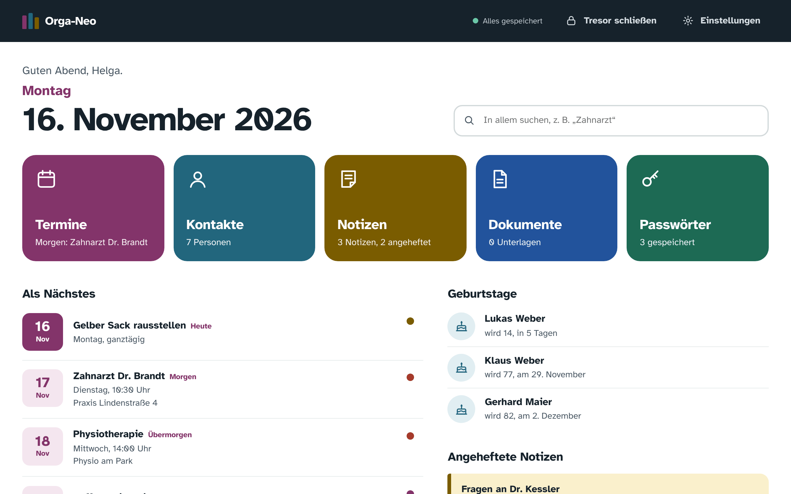
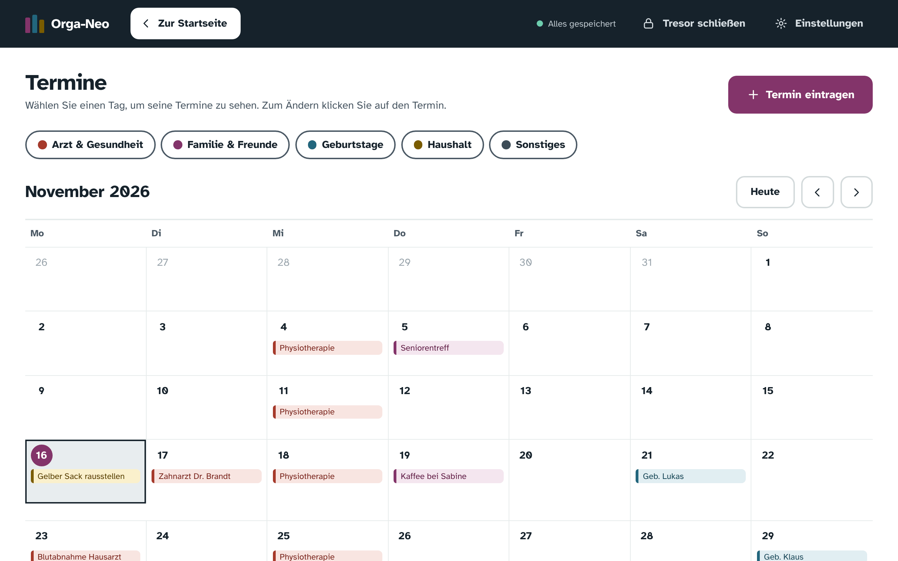
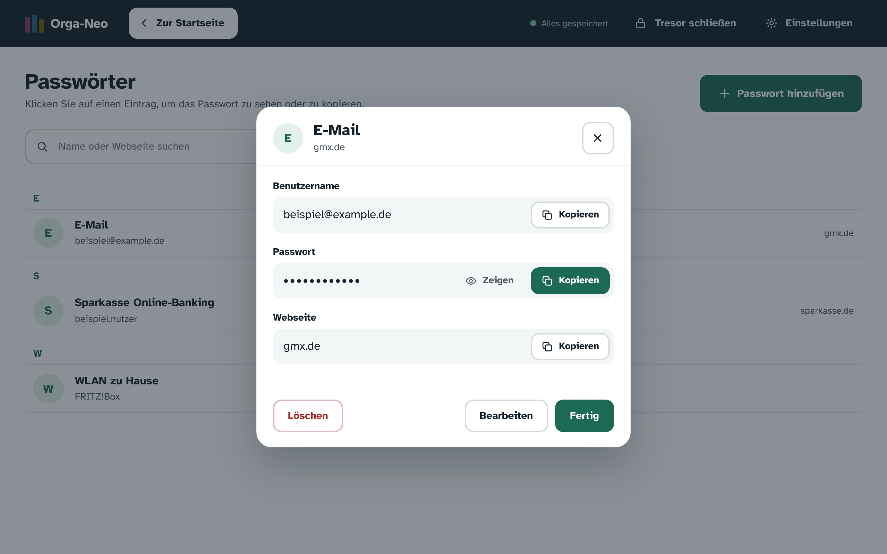
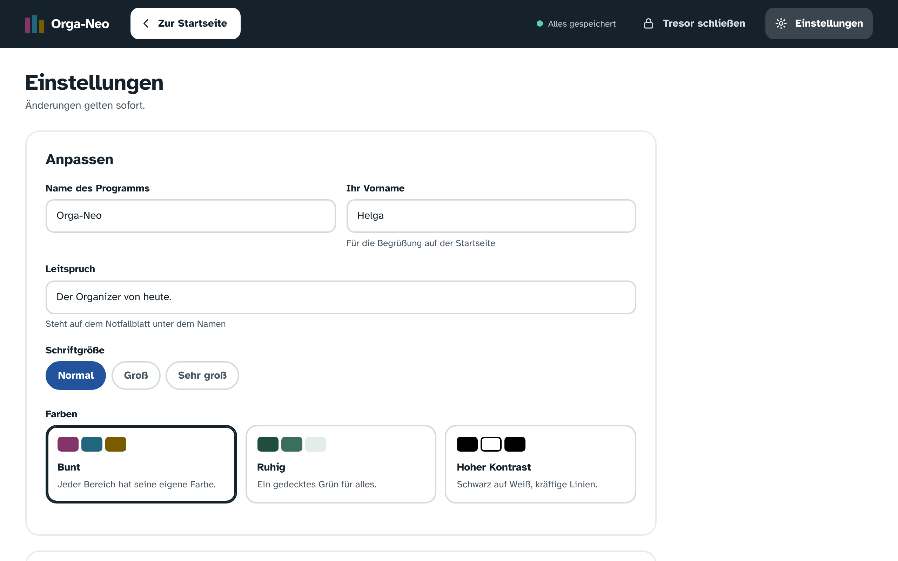

# Orga-Neo

A personal organizer for seniors: appointments, contacts, notes, documents and
passwords in one calm desktop app with large type and one way back to the start
page. The interface is in German.

**Status: early prototype.** Try it with made-up data first. The encryption has
automated tests but has not had an independent security review.

## Screenshots

Taken with the built-in sample data ("Mit Beispieldaten starten").

| | |
|---|---|
|  |  |
| **Startseite**: today, the five areas, what comes next | **Termine**: month view with categories and repeats |
|  |  |
| **Passwörter**: hidden until "Zeigen", one click to copy | **Einstellungen**: name, text size, colours |

## What it does

- **Termine**: month view, categories with colours, repeats, reminders that pop
  up with a sound and stay until answered
- **Kontakte**: phone numbers, addresses and birthdays; birthdays appear in the
  calendar automatically
- **Notizen**: a simple notepad; pinned notes show on the start page
- **Dokumente**: PDFs and photos in folders (one level of subfolders), encrypted
- **Passwörter**: encrypted, with a generator for readable passphrases
- **Anpassen**: name, greeting, text size, colour scheme (colourful, calm,
  high contrast), which tiles appear on the start page and in what order
- **Import / export**: `.ics`, `.vcf`, `.csv` (Edge, Chrome, Bitwarden,
  KeePass), `.txt` / `.md`, and readable copies of all documents

## How data is stored

Everything stays on the PC, by default in `Documents/Orga-Neo`. Another folder,
for example on a USB stick, can be chosen under **Einstellungen → Daten →
Speicherort ändern**: the data is copied there, checked, and only then removed
from the old folder. A folder that already holds Orga-Neo data can be opened
instead. If the chosen folder is not reachable at start, the app says so
rather than starting a new, empty setup. For testing, `ORGA_NEO_DIR` overrides
the setting. Your data is never sent anywhere; the only network access is the
update check, which downloads from GitHub.

| File | Content | Encrypted |
|---|---|---|
| `open.json` | appointments, contacts, notes, settings | no, so reminders work without a password |
| `vault.json` | passwords, document list and folders | yes |
| `docs/<id>.enc` | one file per document | yes |
| `backups/` | daily copies of the two JSON files (14 kept) | as the originals |

Changing the master password or printing a new emergency sheet also updates
the copies in `backups/`, so old passwords and codes stop working there too.

Outside the data folder the app keeps two small files: `settings.json` with a
chosen data folder (in `%APPDATA%\io.github.matthabjan.organeo`), and a log
file for help from a distance (in `%LOCALAPPDATA%\io.github.matthabjan.organeo\logs`,
at most 1 MB, three old copies kept). The log never contains passwords, names
or contents.

A random 256-bit key encrypts the vault and every document with
XChaCha20-Poly1305. That key is stored three times, each copy wrapped with a
key derived by Argon2id from a different secret: the master password, the
recovery code on the owner's printed sheet, and the emergency code for a family
member. Without one of the three, the vault cannot be opened.

## Project layout

```
src/                 the whole interface, TypeScript without a framework
  model.ts           data types, dates, repeating appointments
  io.ts              import and export formats
  backend.ts         the only door to storage (Tauri, or a browser stand-in)
  state.ts           app state, saving, dialogs, the action/form registry
  views/             one file per screen
src-tauri/
  core/              storage and encryption (plain Rust, no Tauri) + tests
  src/lib.rs         thin bridge: exposes core functions to the interface
  src/update.rs      update check and install (GitHub releases)
docs/screenshots/    pictures for this README
```

Most changes (screens, wording, colours, calendar behaviour) only touch `src/`.

## Development

Needs Node 22+, Rust, and on Linux the
[Tauri system packages](https://tauri.app/start/prerequisites/).

```sh
npm install
npm run dev          # interface only, in a browser at localhost:1420
npm run tauri dev    # the real desktop app
npm test             # import/export and calendar tests
cd src-tauri && cargo test -p orga-core   # storage and encryption tests
cd src-tauri && cargo test -p orga-neo    # update error handling (needs the Tauri system packages)
```

In the browser (`npm run dev`) a stand-in keeps data in `localStorage`
**without encryption**. It exists for working on screens only.

## Windows installer

Every push to `main` or `develop`, and every pull request, builds a test
installer on GitHub Actions. Download it
from the run's **Artifacts** (`orga-neo-windows-installer`). Released versions
are on the [Releases](https://github.com/matthabjan/orga-neo/releases) page. The installer is not
code-signed, so Windows shows an "unknown publisher" warning once.

## Updates

The installed app looks for a new version about ten seconds after it starts
(and when the user clicks **Einstellungen → Programm → Nach Updates suchen**).
It reads `latest.json` from the newest GitHub release (pre-releases are not
seen); the download is checked against the public key in `tauri.conf.json`
before it is installed. Check and install run in the Rust part of the app, so
the interface itself has no network access. The browser stand-in never looks
for updates.

The check at start stays silent whatever happens. When the user asks:

| Situation | Message |
|---|---|
| no newer version, or no release published yet | „Sie haben die neueste Version." |
| no internet, or GitHub not reachable | „… Bitte prüfen Sie die Internetverbindung …" |
| anything else (e.g. an unreadable `latest.json`) | „… Bitte versuchen Sie es später noch einmal." and the details go to the log file |

## Releasing a new version

1. Raise the version in `package.json` (`npm version 0.4.0 --no-git-tag-version`)
   and in `src-tauri/Cargo.toml`. `tauri.conf.json` reads it from
   `package.json`. `npm run release -- v0.4.0` checks that they match the tag.
2. Commit, then tag with a short German note for the release page and push:

   ```sh
   git tag -a v0.4.0 -m "Was ist neu"
   git push --follow-tags
   ```

   Without git on hand, **Releases → Draft a new release** on GitHub works
   too: type a new tag `v0.4.0` (with the `v`), target `main`, leave the
   release as a normal release (not a pre-release) and publish it. Publishing
   creates the tag and starts the same build; a draft does not. The release
   notes are then GitHub's generated list unless you edit them afterwards.

GitHub Actions builds the installer, signs the update with the
`TAURI_SIGNING_PRIVATE_KEY` and `TAURI_SIGNING_PRIVATE_KEY_PASSWORD` secrets
and publishes the release "Orga-Neo v0.4.0" with the tag message as its
notes. Installed copies pick it up on their next start.

**Keep the private signing key and its password safe.** If either is lost,
installed copies can no longer be updated: everyone would have to download and
install a new version by hand.

## Not built yet

- Start with Windows and keep reminding from the system tray

## Credits

Typeface: [Atkinson Hyperlegible](https://www.brailleinstitute.org/freefont/)
by the Braille Institute, SIL Open Font License.

## Licence

MIT, see [LICENSE](LICENSE).
